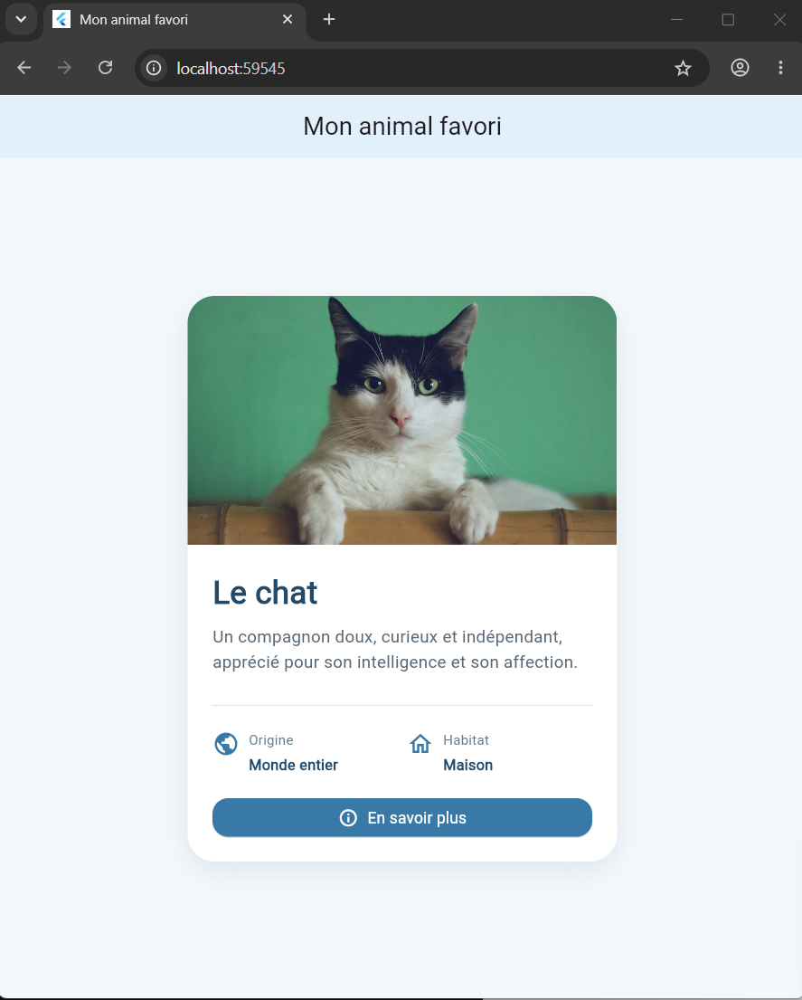

# 🐱 TP3 — Carte d’information : Mon animal favori

<p align="center">
  <strong>Développement mobile avec Flutter</strong><br>
  TP 3 — Widgets et mise en page
</p>

## 📌 Présentation

Ce projet consiste à développer une carte d’information présentant un animal favori à l’aide des widgets fondamentaux de Flutter.

L’interface met en valeur le chat à travers une image, un titre, une description, des informations illustrées par des icônes et un bouton interactif.

## 🎯 Objectifs pédagogiques

- Construire une interface Flutter complète depuis zéro.
- Combiner les widgets de base et de mise en page.
- Organiser les éléments avec `Column` et `Row`.
- Afficher une image avec `Image.network`.
- Personnaliser une carte avec des coins arrondis et une ombre.
- Ajouter des espacements avec `SizedBox`.
- Créer un bouton interactif avec `ElevatedButton`.

## ✨ Fonctionnalités

- Affichage d’une image du chat.
- Présentation du nom et d’une courte description.
- Informations sur l’origine et l’habitat.
- Icônes pour illustrer les informations.
- Bouton « En savoir plus » affichant une fenêtre informative.
- Interface centrée avec un fond bleu clair.
- Affichage d’une icône de remplacement si l’image ne se charge pas.

## 🧩 Widgets utilisés

| Widget | Rôle |
|---|---|
| `MaterialApp` | Configuration de l’application |
| `Scaffold` | Structure de la page |
| `AppBar` | Barre de titre |
| `Center` | Centrage du contenu |
| `Container` | Mise en forme de la carte |
| `Column` | Organisation verticale |
| `Row` | Organisation horizontale |
| `Image.network` | Chargement de l’image |
| `Text` | Affichage des textes |
| `Icon` | Illustration des informations |
| `SizedBox` | Gestion des espacements |
| `Divider` | Séparation des sections |
| `ElevatedButton` | Bouton d’action |
| `AlertDialog` | Fenêtre d’information |

## 🖼️ Capture d’écran




## 🛠️ Technologies utilisées

- **Flutter** : framework de développement mobile.
- **Dart** : langage de programmation.
- **Visual Studio Code** : environnement de développement.
- **Git et GitHub** : gestion de versions et hébergement du code.

## 📁 Structure du projet

```text
tp3_animal_card/
├── lib/
│   └── main.dart
├── screenshots/
│   └── animal.png
├── test/
├── android/
├── ios/
├── web/
├── windows/
├── pubspec.yaml
├── pubspec.lock
├── analysis_options.yaml
└── README.md
```

## ⚙️ Installation et exécution

### Prérequis

- Flutter installé et configuré.
- Dart, fourni avec Flutter.
- Un navigateur compatible ou un appareil de test.

### Étapes

1. Cloner le dépôt :

   ```bash
   git clone https://github.com/UAS2K27Flutter/tp3_animal_card.git
   ```

2. Accéder au projet :

   ```bash
   cd tp3_animal_card
   ```

3. Installer les dépendances :

   ```bash
   flutter pub get
   ```

4. Lancer l’application dans Chrome :

   ```bash
   flutter run -d chrome
   ```

## 👩‍💻 Auteur

**Kaabi Hiba**  
Université Arabe des Sciences (UAS)  
Année universitaire 2026–2027
